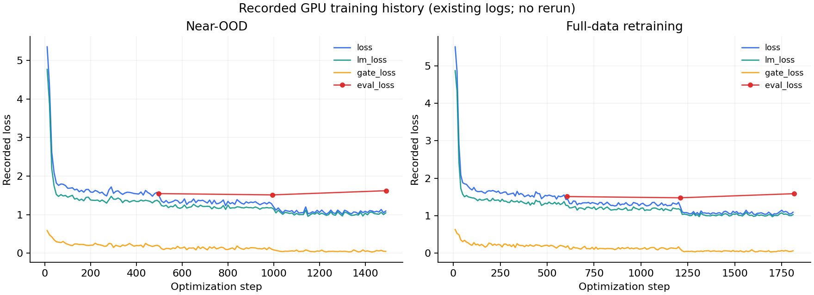

# Related Search: Qwen3-4B + LoRA + Gate Head

相关搜索推荐微调实验：联合训练生成 LoRA 与是否展示推荐词的判断头，使用语义簇留出和缓冲带构建 near-OOD 测试，分别评估 ID / OOD。

## 内容

- 根目录：数据划分、训练、推理、评估、网页 Demo 与 CPU 玩具模型测试。
- `data/cleaned_dataset.csv`：已有清洗数据，19,847 行 query / 相关搜索词。
- `docs/`：历史训练指南与 2026-09-23 的完整实验总结。
- `results/`：已有划分统计、训练日志和聚合评估，保留历史结果，未重新训练。
- `released_adapter/`：本地 `final_adapter.zip` 中的 LoRA、gate head、tokenizer 和 prompt；不包含基础 Qwen 模型。

## 已有训练日志

下图直接绘制于两次实验最后一个 checkpoint 的 `trainer_state.json`，没有重训或平滑处理；可用 `python plot_training_history.py` 从已保存的日志重新绘制。



## 还原已有参数

```bash
python restore_adapter.py
```

`adapter_model.safetensors` 约 126 MiB，超过 GitHub 单文件上限，因此按 4 MiB 分块提交。脚本逐块检查 SHA-256，再检查完整文件哈希；还原后的权重与原始 ZIP 中的权重逐字节相同。适配器配置里的服务器绝对路径改为基础模型 ID `Qwen/Qwen3-4B-Instruct-2507`，权重未修改。

下载基础模型、安装 `requirements.txt` 后，可按训练指南运行，或使用已保存的适配器：

```bash
python try_gate.py --adapter released_adapter --base-model models/Qwen3-4B-Instruct-2507 --query "咖啡杯"
```

`--base-model` 以 `python try_gate.py --help` 为准，其他训练路径也可由 CLI 指定；历史指南中的 `/root/autodl-tmp` 路径需改成自己的目录。门控阈值与 near-OOD 范围请结合实验总结和 `gate_config.json` 阅读。

本次公开整理不运行 GPU 训练或 API 请求。不包含 Cookie、采集浏览器 profiles、真实线上用户数据、生产库配置、环境目录或基础模型权重。基础模型与 tokenizer 的原有许可证和使用条件继续适用。
